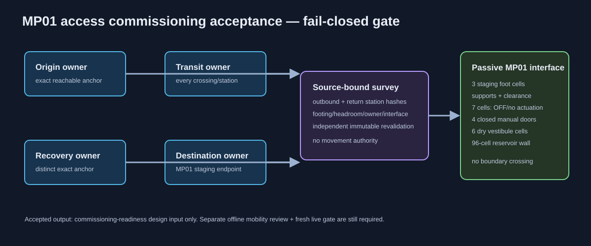

# MP01 access commissioning acceptance signature 01

**Status:** `DEFAULT_DENY_TEMPLATE_NOT_COMMISSIONED`.



The normal-walk survey proves immutable-source route geometry; this signature is the next, separate decision gate. It requires four distinct named parties: an origin owner, a transit owner, the MP01 destination owner, and a recovery owner. It binds their exact anchors, every surveyed outbound/return station, and the protected destination condition.

The compiler rejects a placeholder, a changed survey, missing return responsibility, any station outside named ownership, a route not independently revalidated against the immutable source, or drift in any of the following destination sets:

- all three polished-andesite staging supports and six clearance cells;
- the seven-cell reactive-control boundary in its passive OFF/no-actuation state;
- four closed/unpowered manual door leaves, six dry vestibule cells, and the 96-cell white-concrete reservoir wall.

An accepted result is only a commissioning-readiness design input. It does not authorize bot movement, route/marker/config/catalog change, control actuation, RCON, operations, a physical release, public/service access, egress, or MP01 completion. Before any supervised movement, a separate exact-corridor offline mobility review and a fresh live safety gate remain mandatory.

Run the regression with:

```bash
npx vitest run test/build/mp01AccessCommissioningAcceptanceSignature.test.ts
```
