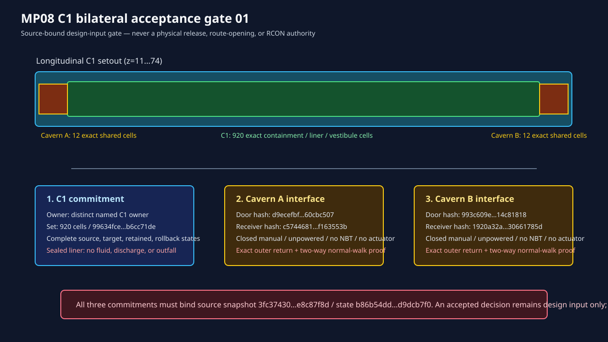

# MP08 C1 bilateral acceptance signature 01

This is a fail-closed design-input gate for the C1 containment reservation. It
does not authorize a physical build, a route opening, RCON, transport, public
access, fluid discharge, C2, Cavern C, RR-N6, or T4 work.



## Required inputs

Start from [the signature template](MP08-C1-BILATERAL-ACCEPTANCE-SIGNATURE-01.template.json), then provide all of the following from a single source-bound contract:

1. Three distinct named owners: C1, Cavern A, and Cavern B.
2. Exact C1 / Cavern A / Cavern B owned coordinate-set hashes and complete
   target, retained, rollback, and source state-set commitments.
3. Exact inverse evidence; an explicit container/block-entity exclusion for
   each owner; and the sealed C1 no-fluid/no-outfall policy.
4. Both exact door and receiver hashes, closed-manual/no-NBT/no-actuator and
   no-discharge acceptance, an independently hashed bidirectional normal-walk
   proof, and a named coordinate return anchor outside each receiver.

Run the compiler only as a read-only check:

```bash
node scripts/compile_mp08_c1_bilateral_acceptance_signature.mjs \
  --contract data/world-review/mp08-c1-bilateral-containment-contract-02-mp01-anvil-post-20260826T163300Z/mp08-c1-bilateral-containment-contract-02.json \
  --signature <completed-signature.json> \
  --out <decision.json>
```

An `ACCEPTED_DESIGN_INPUT_NOT_RELEASE_AUTHORITY` result is merely a complete
design input. The next compiler must rebind it to a fresh complete immutable
source and pass the full guarded release kernel before it can emit an offline
forward/rollback package.
