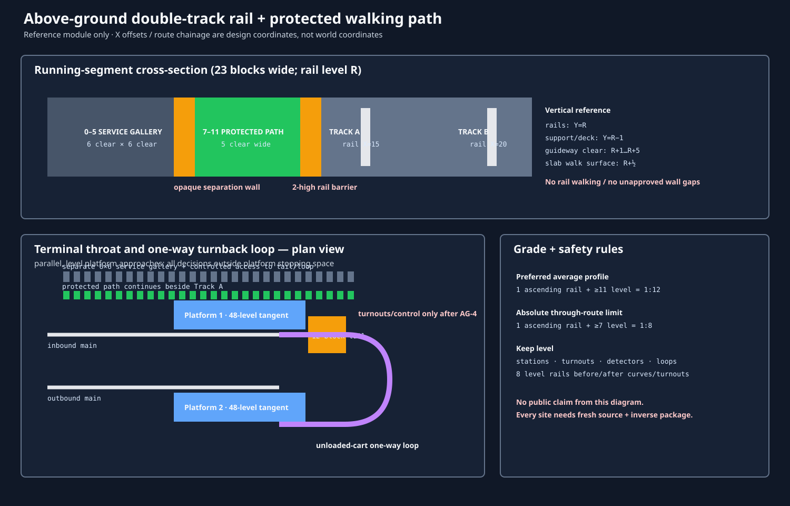

# Above-ground double-track rail with protected walking path

**Status:** `REFERENCE ENGINEERING STANDARD — DESIGN ONLY`  
**Scope:** reusable Minecraft geometry for a new elevated or embanked,
directional double-track route. It does not select an alignment, authorize a
world edit, open passenger service, or convert an existing rail asset.

This is a companion to the [Passenger Railway Engineering Standard](PASSENGER-RAILWAY-ENGINEERING-STANDARD-2026-08-22.md). It retains its requirements for a continuous separate 6×6 service gallery, exact source/rollback states, controlled cross-passages, and staged passenger acceptance. The supplied Toronto Union reference is treated as an inspiration for an orderly terminal throat—parallel platform approaches and route separation—not as a literal Minecraft copy. No supplied drawing was present in this workspace, so this document does not claim a traced or measured interpretation of it.

## 1. Design decision

Use a **directional double-track main** with one protected five-wide walking
path beside it and a separate six-wide service gallery behind an opaque wall.
The walking path is an everyday inspection/evacuation route; it is not the rail
bed, not the service gallery, and not by itself a public station exit. The two
tracks never merge on a through segment.

The standard module is deliberately wider than a bare two-track viaduct. That
is the cost of a route people can walk beside safely without stepping on rail,
and of maintaining the already-required independent service path.

## 2. Exact repeatable running cross-section

Set a segment's rail-block Y level to **R**. Rails occupy Y=R and sit on
documented non-gravity support at Y=R−1. The reference width is 23 blocks,
indexed from the service side to the outer running side.

| X offset | Allocation | Required state/clearance |
|---:|---|---|
| 0–5 | Service gallery | Six clear wide × six clear high, lit, normally staff-only. Its walking surface may be bottom slabs at Y=R so it remains level with the protected path. |
| 6 | Service separation wall | Continuous opaque structural wall, Y=R..R+5. Only named 3×3 lockable cross-passages may interrupt it. |
| 7–11 | Protected walking path | Five clear wide; bottom-slab deck at Y=R, normal-walk path, continuous outer-edge guard/parapet where exposed. |
| 12 | Rail-side protection | Continuous two-block-high impact/fall barrier at Y=R..R+1. It has no unapproved gaps. |
| 13–16 | Track A running lane | Rail centre at X=15. X=13 is the outer cess and X=16 is the inner cess. Maintain clear space Y=R+1..R+5. |
| 17–18 | Intertrack zone | Two-block clear/structural median. No walkway, platform furniture, or turnout mechanism box here. |
| 19–22 | Track B running lane | Rail centre at X=20. X=19 is the inner cess and X=22 is the outer cess. Maintain clear space Y=R+1..R+5. |

Track centres are exactly five blocks apart (X=15 and X=20). Build the
under-deck as a continuous 23-wide structural slab at Y=R−1, with a site-bound
girder/footing design below it. A reference viaduct module uses a 3×3 pier at
12-block centres, a two-block-deep transverse deck beam under each pier line,
and a 23×2 longitudinal deck girder. That module is a geometry target only:
every actual pier, footing, water crossing, and protected ground contact must
be source-surveyed and separately owned.

The outer running edge (X=23) receives a two-high containment parapet. The
service outer edge (X=−1) receives a two-high guard/wall appropriate to the
site. Neither parapet narrows the clear gallery or protected walking path.

### Why both paths exist

- The **five-wide protected path** is continuously beside the guideway and is
  useful for normal inspection, wayfinding, and a stopped-cart walk-off.
- The **six-wide service gallery** remains separately walled, independently
  lit, and connected through controlled cross-passages. It carries recovery,
  utilities, maintenance stores, and service exits without treating the public
  walking path as a secure maintenance corridor.

Neither one counts as one of an underground station's two independently proven
public exits without its own route proof.

## 3. Vertical alignment, curves, and drainage

Minecraft rail rises on a full one-block ascending rail. Therefore the stated
grade is an **average profile**, not a claim that a rail can form a fractional
slope in a single cell.

- Preferred profile: one ascending rail followed by at least **11 level rail
  cells** before the next rise/fall: no steeper than 1:12 average.
- Absolute through-route limit: one ascending rail followed by at least **7
  level rail cells**: no steeper than 1:8 average.
- Stations, platforms, turnout detection zones, cross-passage landings,
  platform doors, and terminal loops are level. Keep eight level rail cells
  before and after every cardinal turn, turnout throat, and terminal stop zone.
- Use cardinal curves only. A curve is a named low-speed interlocking element,
  never a blind diagonal or an unsurveyed shape change.
- Keep deck falls/drains outside rail support cells. Where water or lava is
  encountered, first build a finite, sealed, supported containment liner/plug
  with a directed receiver and reverse order that never reopens a live flow
  path. Do not drain across the walking path, service gallery, or track bed.

Powered-rail spacing is not assumed by this document. C1's existing 38-flat /
4-climb planning target may be reused only where its live loaded-cart test is
repeated. Every other alignment first receives a recorded flat, climb, stop,
and return test to set its own cadence.

## 4. Stations and protected boarding

### Ordinary through station

An ordinary above-ground station is built on a **48-block level tangent**.
Provide one side platform for each track, each at least five clear blocks wide;
at entrances, stair/lift landings, map boards, and queuing points, keep seven
clear blocks. The protected walking path becomes the back-of-house/public
circulation aisle of the Track A platform but stays behind the rail-side
barrier. Track B receives its own outer side platform; passengers never cross
Track A or Track B at grade.

- Platform edge: continuous contrasting edge plus a physical fall-prevention
  barrier wherever there is no approved boarding zone.
- Boarding zone: a named, normally closed 3-wide gate/barrier opening aligned
  to the tested cart stopping cell. It is part of the station-control package,
  not civil works.
- Access: a five-clear-wide primary route, two separately proven exits, and a
  separately tested no-jump return/lift analogue for underground or elevated
  platforms.
- Service: a normally locked 3×3 vestibule from the gallery at **both** station
  ends. It is not a passenger entrance.
- Recovery: one 3×3 passing/recovery bay outside the 6×6 service clear volume
  for every 64 route blocks, and a cross-passage at each station end.

### Terminal and Toronto-Union-style throat

Use the visual logic of a major terminal throat—parallel approach tracks,
platform tangents before decisions, and all routing outside passenger stopping
space—but keep Minecraft's first operating stage deliberately simple.

1. Bring the two directional mains straight through at least **32 level rail
   cells** before the first turnout lead.
2. Provide two parallel 48-block terminal platform tracks. An inbound cart
   stops at Platform 1; passengers leave before any cart moves to a turnback.
3. Beyond the platform stop zone provide a **12-block fenced recovery tail**,
   arrival detector, dead-stop protection, and manual recovery access from the
   service gallery.
4. At each end of a line, one separately walled **one-way terminal loop** may
   take the unloaded cart from Platform 1 to the opposite-direction Platform 2.
   The loop has two named cardinal curves, eight level cells before/after each
   curve, a minimum 24-block level cart-recovery segment, and a direct service
   gallery route alongside it. It does not permit through-riders to remain in
   the cart.
5. A paired terminal has one independent loop at each geographic terminal,
   not a central crossing. No at-grade crossover is permitted inside a public
   platform envelope.

### Turnouts and interlocking

Turnouts belong in a later terminal/control package, never in the first civil
release. Each turnout must have:

- eight level rails on each approach/exit, a named route ID, an owner, exact
  rail-shape states, a detector before the points and an occupancy detector
  after the fouling point;
- a manually verifiable default of `STOP / route locked / launch unpowered`;
- an independently owned switch machine/control niche on the service side,
  never in the intertrack zone or public clear path;
- a forward/return route-lock test, occupied-route launch rejection, power-loss
  stop, manual recovery, and reset evidence before vehicle use.

Until those tests pass, terminal rails are fixed-route, passive, and capped
beyond the proved recovery tail.

## 5. Lighting, fall protection, operations, and signage

- Install a continuous visible lighting rhythm along both the protected path
  and gallery. Add fixed light at each pier bay, turnout, cross-passage,
  station edge, service exit, terminal tail, and control niche. Verify no dark
  walk cells using the project light proxy and post-state screenshots in both
  directions.
- Use continuous two-high barriers along exposed outer edges and along the
  rail-side path boundary. Do not substitute trapdoors, a one-block curb,
  railings that can be jumped, or open gaps for a protective barrier.
- Mark every 16 blocks with route/chainage direction; mark service nodes,
  cross-passages, terminal tails, and emergency walk-off gates with segment ID
  and a destination arrow.
- A stopped-cart evacuation must reach the protected walking path or a named
  3×3 cross-passage without jumping, crouching, walking on rail, or entering a
  restricted room. Test both directions at every block boundary.
- No automatic passenger opening follows civil completion. The first operating
  mode is one cart per direction, manual dispatch, and a known recovery zone
  for power loss or an occupied block.

## 6. Reversible package and acceptance rules

Every actual alignment is split so that a later uncertainty cannot widen an
earlier release. The package order is:

| Package | Exact bounded content | Required closeout before next package |
|---|---|---|
| AG-0 | Fresh source survey: terrain, water/lava, gravity, piers, protected interfaces, owners, entities, containers, and candidate path/gallery routes | Integer route and no-build map; no mutation. |
| AG-1 | Footings, piers, containment, and deck girder | Exact support/flow QA and rollback preflight. |
| AG-2 | Deck, parapets, rail/service separation walls, 5-wide protected path, 6×6 gallery, cross-passages, drains, and fixed lighting | Bidirectional no-jump path/gallery QA; no rail operation. |
| AG-3 | Passive rails, fixed terminal tail/loop geometry, platform edge barriers, and recovery niches | Rail shape, support, clearance, fall, and stranded-cart walking QA. |
| AG-4 | Turnouts, detectors, power, signals, gates, and control niches | Default-state, route-lock, occupied-block, power-loss, manual-recovery tests. |
| AG-5 | One-cart closed trials then named station-pair opening | Fresh entity census, ride/return/evacuation/reset logs, maps/signs, post snapshot. |

For each physical package, capture a fresh immutable source, bind canonical
states for every target and halo, emit exact forward and reverse operations,
exclude or migrate every container/block entity/protected core, clear live
entities immediately before mutation, run strict-noop parsers and exact source
preflight, journal the execution, take a fresh post snapshot, then run route
QA and rollback post-state preflight. Rollback reverses packages in reverse
dependency order: controls → rails/platform controls → path/gallery/deck →
piers/containment. It must never recreate an uncontrolled fluid path or leave
a vehicle without a supported rail/recovery route.

## 7. Reference-map interpretation

The accompanying map is a **module diagram**, not a site alignment, Y datum,
or claim that any station, turnout, terminal loop, or Toronto Union feature is
already built. Before using it, replace every reference offset with a fresh
source-bound centreline, platform bounds, pier cells, ownership matrix,
protected-core boundary, and canonical target/rollback states.

