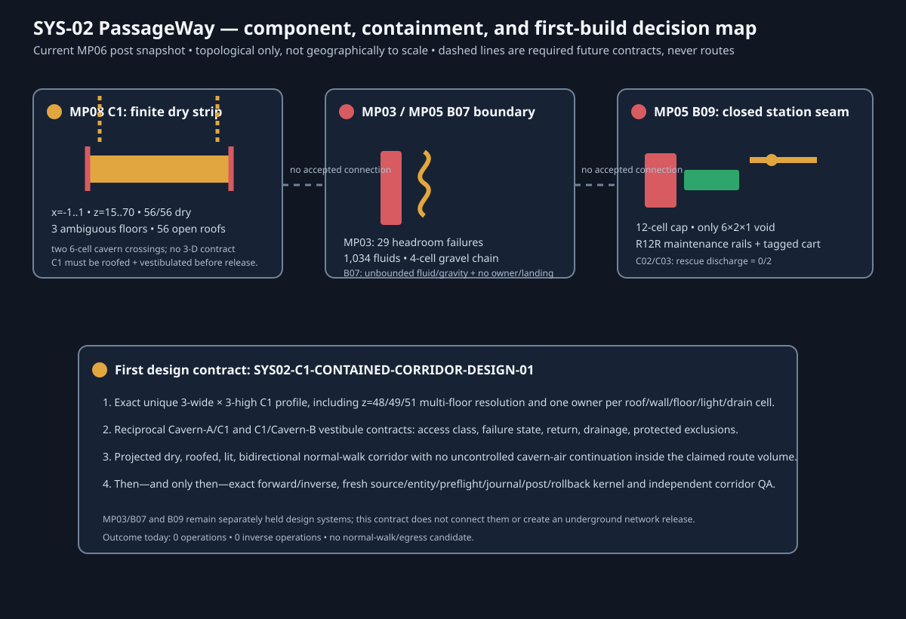

# SYS-02 PassageWay network interface and first-build setout 01

**Status:** `NO_DISJOINT_OWNED_NORMAL_WALK_OR_EGRESS_CANDIDATE`  
**Mode:** read-only current-source network reconciliation and design contract.
No capture, RCON, operation compiler, fleet action, or world mutation occurred.

## Current-source basis

The screen is bound to
`data/worldsnap-mp06-endpoint-elevated-crossing-post-20260826T143902Z`
(region SHA-256
`c75307cbef3c7da76dcff63bd4f33af1c8f4d78a67fb9831258b3d07370f8d05`).
It renews the MP08 C1 Anvil/complete-save screen against that source and
reconciles it with the current MP03 and MP05 B07/B09 source-bound designs.

This is a topology and interface decision map, not a claim that the shown
components are connected, accepted as public, or geographically drawn to
scale. Grey dashed links name required future contracts; they are not routes,
proposed tunnels, or operations.

## Component and interface register

| Component / interface | Exact current evidence | Network disposition |
| --- | --- | --- |
| **MP08 C1, Cavern A ↔ Cavern B** | At `x=-1..1`, `z=15..70`, the selected strip has 56/56 dry three-wide two-clear walking stations, zero core hazards and zero core block entities. Yet all 56 stations are vertically open; `z=48`, `49`, and `51` have multiple valid floors; and each end has six open crossing cells into a cavern. | A dry strip is not a contained corridor, egress, or emergency route. It needs an exact 3-wide × 3-high profile, roof/walls, two vestibule/return interfaces, drainage, lighting, and a 3-D ownership contract. |
| **MP03 Houston lower lobby ↔ B07** | The lower lobby has 34 already-built clear stations and 29 headroom failures. Its necessary vertical band has 1,034 fluid/waterlogged cells. The gravel chain at `(2104,27..30,-396)` is unsupported at its base; the R09J cap and doorless R07J headhouse remain retained closed assets. | No lobby clearance, cap, headhouse, or wayfinding fragment is safe. MP03 is a functional consumer of the one future MP05 B07 containment/gravity/access transaction. |
| **MP05 B07 ↔ exterior receiver** | B07 has 8,134 construction and 13,608 interaction cells; five construction/89 interaction fluid contacts belong to a capped 125,000-cell trace with 1,789 unexpanded frontier cells. It also has 90 gravity cells, 11 air-supported chains, zero accepted owner, and no owned terrain landing/descent. | No finite hydrology, permanent-gravity inverse, receiver, lower-to-surface normal-walk route, or return/egress endpoint exists. This is the principal current network containment boundary, not an opening opportunity. |
| **MP05 B09, B08 lower seam ↔ R12R/C02/C03** | B08/B09 retains a closed 12-cell polished-diorite cap and a 12-air-cell `6×2×1` void; R12R is 15 unpowered powered rails, two off controls, and one authenticated cart. C02/C03 geometry has zero accepted rescue discharges (`0/2`). | Not a station, passenger corridor, or rescue route. It requires bidirectional endpoint contracts, a contained receiver/platform/edge barrier, independent service/egress, drainage, controls, and two independently proved discharges. |
| **Existing recorded SYS-02 normal-walk traces** | The earlier network QA recorded 21/22 representative routes and 42/44 directions, but those passing components are already present and are not newly reviewed construction targets. Its remaining Observatory portal-to-hub proposal fails both projected directions. | Preserve as evidence of local traversability only. Do not duplicate-build a route or turn the Observatory secret-door/stair/landing redesign into a bounded three-cell repair. |

## Candidate screen

No component passes every required candidate condition:

| Candidate condition | C1 | MP03/B07 | B09 |
| --- | :---: | :---: | :---: |
| Exact functional defect with two classified endpoints | no | no | no |
| One accepted 3-D owner and counterpart interface owner | no | no | no |
| Contained/support-safe normal-walk envelope | no | no | no |
| Drainage/fluid/gravity/failure state resolved | no | no | no |
| Exact source/post states and exact inverse designable | no | no | no |
| Independent egress/return result definable | no | no | no |

There is therefore no operation, inverse, or release candidate from this
screen. Existing paths and broad dry voids were intentionally excluded.

## First-build contract — `SYS02-C1-CONTAINED-CORRIDOR-DESIGN-01`

The shortest bounded **design** successor is a contained C1 corridor—not an
immediate physical release—because its present walking observation is a finite
56-station strip. It becomes eligible to compile only after every acceptance
artifact below is accepted together. This choice neither connects C1 to MP03/
MP05 nor supersedes their independent containment work.

1. **Authority and profile.** Adopt one exact C1 route volume covering the
   unique floor at every `z=15..70` station; resolve the three multi-floor
   stations explicitly; assign one owner to every roof, wall, floor, light,
   drainage, door, and interaction cell.
2. **Cavern interfaces.** Adopt separate reciprocal contracts for the six-cell
   Cavern-A/C1 and six-cell C1/Cavern-B crossing sets. Each must define a
   vestibule, access class, lock/failure state, protected-cavern exclusions,
   normal-walk return, and post-state containment; a point catalog record is
   not an interface contract.
3. **Contained route design.** Project-test a continuous 3-wide × 3-high
   corridor, roof and walls, non-ambiguous floor, lighting cadence, dry support,
   drainage, two-direction normal walking, and a return/egress path. No
   unbounded cavern-air continuation may remain inside the claimed corridor
   envelope.
4. **Exact package and release kernel.** Only after steps 1–3 can a compiler
   create exact source-to-target and reverse operations, exclude/migrate block
   entities and protected cores, and pass fresh source, live-entity, strict
   parser/source preflight, journal, post-snapshot, rollback, and independent
   corridor/vestibule QA.

MP03/B07 and B09 remain separate preconditions for any future cross-system
PassageWay connection. Their first legal action is design evidence, not an
opening: B07 needs finite hydraulic/overflow treatment plus permanent gravity
and exterior receiver ownership; B09 needs both endpoint contracts, two rescue
discharges, and an operating-system design.

## Explicit non-claims

This setout does not accept or propose an underground network connection,
public route, emergency egress, accessibility route, C1 corridor, B07 opening,
B09 station, rail service, or Observatory repair. It creates no route, marker,
catalog record, operation file, or world change.

## Evidence and renewed map

- [Fresh MP08 C1 current-source screen](../../data/world-review/mp08-c1-contained-route-screen-03-current-mp06-post-20260826T143902Z/MP08-C1-CONTAINED-ROUTE-SCREEN-02.md)
- [MP03 integrated access current design](../../data/world-review/mp03-integrated-access-design-02-current-mp06-post-20260826T143902Z/mp03-integrated-access-design.json)
- [MP05 B07 first viable contract](05-combined-zones/MP05-B07-FIRST-VIABLE-RELEASE-CONTRACT-02-2026-08-26.md)
- [MP05 B09 current interface/rescue setout](05-combined-zones/MP05-B09-CURRENT-INTERFACE-RESCUE-SETOUT-02-2026-08-26.md)
- [SYS-02 Observatory projection hold](../../data/world-review/sys02-obs-stair-live-20260826T115130Z/THREE-CELL-PROJECTION-HOLD.md)
