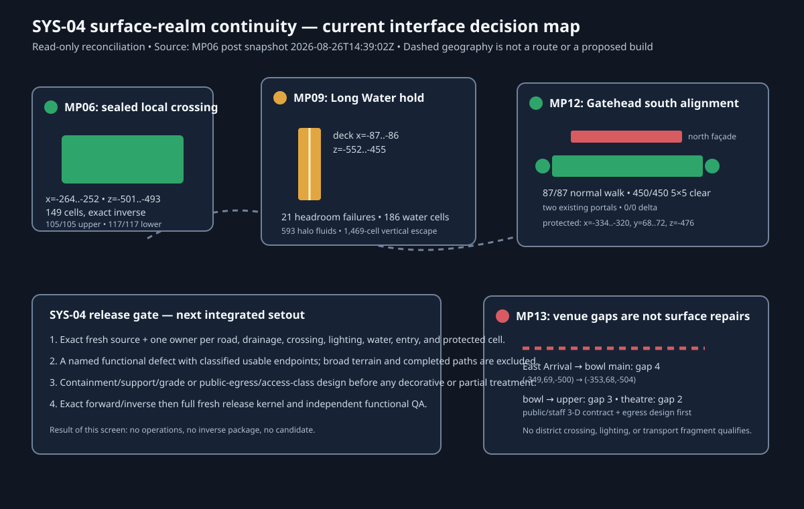

# SYS-04 surface-realm continuity setout 01

**Status:** `NO_SAFE_OWNED_REVERSIBLE_CROSS-DISTRICT_CANDIDATE`  
**Mode:** read-only interface reconciliation and design setout. No capture,
RCON, operation compilation, fleet action, or world mutation occurred.

## Current-source basis

This screen uses the latest complete MP06 endpoint-crossing post snapshot
`data/worldsnap-mp06-endpoint-elevated-crossing-post-20260826T143902Z`
(region SHA-256
`c75307cbef3c7da76dcff63bd4f33af1c8f4d78a67fb9831258b3d07370f8d05`) for
the MP09 and MP12 observations and for the current district-to-venue route
gaps. The sealed MP06 crossing ledger is source/post-bound to the same
release interval. MP13's separate high-deck design remains an ownership and
access-class hold; it is used here only to classify the venue gaps, never as a
current execution source.

This is a SYS-04 boundary screen, not a claim that the four sites are adjacent
or that a schematic line is a traversable city route. The map preserves their
actual coordinate relationship and records where each local result stops.

## Reconciled interface disposition

| Interface / exact witness | Current result | Why it cannot be a SYS-04 package |
| --- | --- | --- |
| **MP06 elevated crossing** `x=-264..-252`, `z=-501..-493` | **As-built and sealed:** 149 exact cells; independent QA retains `105/105` elevated stations, `98/98` directed elevated pairs, and `117/117` lower-road stations. | It deliberately preserves 351 lower-road cells and does not prove external endpoint, drainage, road, or regional continuity. It is an accepted local crossing, not a new delta. |
| **MP09 Long Water** deck band `x=-87..-86`, `y=67..69`, `z=-552..-455`; Tempietto entrance `(-85,69,-552)` | The only named unbuilt Ravensgate alignment: 21 headroom failures, 186 source-water displacement cells at y66, 593 halo fluids, and a 1,469-cell component exiting the surveyed y64..70 volume. | No exact hydrology, water-displacement, grade, or landing owner exists. A deck, paving, lighting, liner, or landing alone would be hydraulically and ownership incomplete. |
| **MP12 Gatehead south alignment** from `(-338,68,-484)` toward East Arrival `(-284,68,-494)` | **Already present:** 87/87 normal-walk witness, 450/450 clear/dry central 5×5 cells, two existing 45-cell portals, and zero block entities. | `0/0` forward/rollback delta. North widening instead intersects 75 protected façade cells at `x=-334..-320`, `y=68..72`, `z=-476`. Lighting-only changes remain unowned and cannot substitute for a defect. |
| **MP12→MP13 East Arrival / venue boundary** | A 22-station diagnostic trace reaches the bowl-east anchor. Missing normal-walk components are nearest at `(-349,69,-500)→(-353,68,-504)` (gap 4), `(-403,70,-560)→(-406,73,-563)` (gap 3), and `(-367,34,-550)→(-365,36,-552)` (gap 2). | Those are MP13 public vertical/egress interfaces, not a district crossing or transport defect. They require a public/staff 3-D ownership contract and independent venue egress/accessibility design; a surface patch would not create a safe endpoint. |
| **MP12 shoreline / transport** | No source-backed exact defect, target geometry, route endpoint, containment treatment, ownership, or inverse is accepted. | Broad district, Town Expansion, and venue catalogue envelopes are not construction authority. Paving a shoreline/dock/rail fragment would invent scope. |

## Detailed decision map

The map is deliberately a **decision map** rather than invented street design:

- green is an accepted, already-built local witness;
- amber is a named but integrated design dependency;
- red is a protected/owned interface boundary or functional gap;
- grey dashed lines are geographic context only and carry no route acceptance.

No rectangle, gap, or dashed link is a proposed block set. The only exact
physical coordinate ranges above are evidence witnesses or protected limits.

## Next integrated SYS-04 setout

The next valid work is not a citywide paving or lighting pass. Select **one**
named interface and produce this ordered package before a compiler may emit
operations:

1. Bind a fresh complete snapshot and one owner per affected road, bridge,
   drainage, crossing, lighting, entry, protected-fabric, water, and endpoint
   cell. Record each cross-programme threshold explicitly; broad envelopes do
   not count.
2. Define a functional defect and an acceptance path. It must begin and end at
   classified usable interfaces and state the required drainage/containment,
   normal-walk, lighting, and accessible-entry result.
3. For water or grade work, first prove the complete fluid/structural boundary
   and design containment/support/landing as a single dependency-ordered
   system. For venue work, separately prove public egress and staff separation;
   the staff tower is not public egress.
4. Only then generate exact source-to-target and exact inverse operations,
   exclude protected fabric and block entities (or provide an exact reviewed
   migration), and run the fresh entity, strict-noop, journal, post-snapshot,
   rollback, and independent functional QA kernel.

## Explicit non-claims

This screen does not accept a citywide route, road drainage, lighting network,
shoreline/transport system, public venue egress, accessibility, or any
operation. It does not turn diagnostic normal-walk searches into public-route
certification and does not reclassify as-built work as a candidate.

## Evidence

- [MP06 sealed endpoint crossing ledger](../../data/world-review/mp06-endpoint-elevated-crossing-live-20260826T143902Z/evidence-ledger.json)
- [MP09 Long Water current integrated design](09-ravensgate/MP09-LONG-WATER-INTEGRATED-DESIGN-02-2026-08-26.md)
- [MP12 current interface setout](12-westlight-district/MP12-CURRENT-INTERFACE-SETTOUT-02-2026-08-26.md)
- [MP12 current route survey](../../data/world-review/mp12-westlight-interface-screen-current-mp06-post-20260826T143902Z/westlight-arrival-circulation-survey.md)
- [MP13 high-deck / egress design hold](../../data/world-review/mp13-high-deck-merge-current-20260826T141000Z/design/MP13-HIGH-DECK-MERGE-INTEGRATED-DESIGN-02.md)
