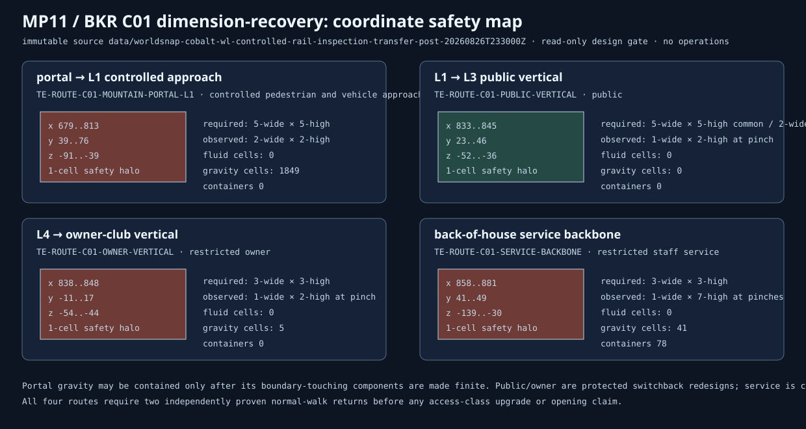

# MP11 / BKR C01 dimension-recovery design gate 01

**Status:** `HOLD_SOURCE_BOUND_WHOLE_SCOPE_DESIGN_REQUIRED_BEFORE_PHYSICAL_DIMENSION_RECOVERY`  
**Authority:** read-only design input; no operations or mutation authority.

The fresh immutable source confirms a real functional defect: portal, public, owner, and staff circulation are below their respective required clear envelopes. The whole-scope recovery is held because the portal gravity boundary is not finite and the service pinches are bounded by exact barrel containers. The public and owner defects are protected switchback redesigns, not raw-rock widening.

The first possible physical package is **C01-DIMENSION-PHYSICAL-01**, a finite gravity-containment liner or fully separated dry bypass only after every condition in the JSON report passes. It cannot widen, open, or reclassify a route.
