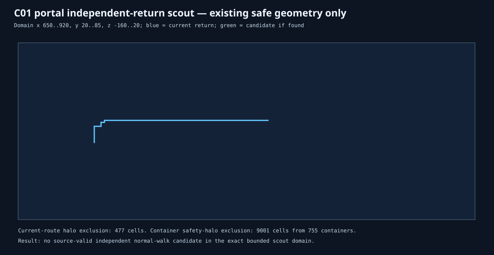

# MP11 / BKR C01 independent portal-return scout 01

**Status:** `NO_SOURCE_VALID_INDEPENDENT_PORTAL_RETURN_CANDIDATE_IN_BOUNDED_DOMAIN`  
**Authority:** read-only scout; no physical operations.

This scout considers existing normal-walk geometry only. It excludes the current portal-to-L1 return’s interior one-cell halo, every source container’s one-cell cube halo, and all fluid/waterlogged feet/head/safety-halo cells. It found no candidate in the exact bounded domain; no speculative tunnel is inferred.
