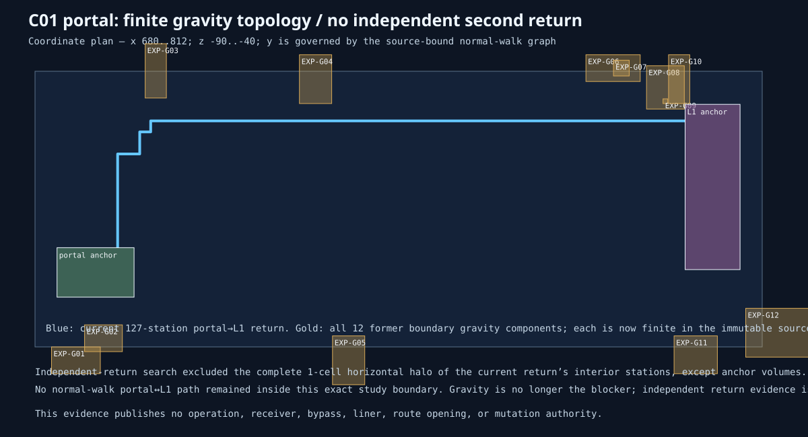

# MP11 / BKR C01 no-second-return contract 01

**Status:** `INDEPENDENT_RETURN_REQUIRED_GRAVITY_TOPOLOGY_FINITE`  
**Authority:** evidence only; no operation or mutation authority.

All **12** expanded former-boundary gravity components are finite in the immutable source. Gravity topology is therefore no longer the current blocker. The current portal-to-L1 return has **127** stations, but no second normal-walk return survives exclusion of its exact one-cell interior halo. A separately source-bound independent return is required before any portal liner or dry-bypass package may be compiled.
