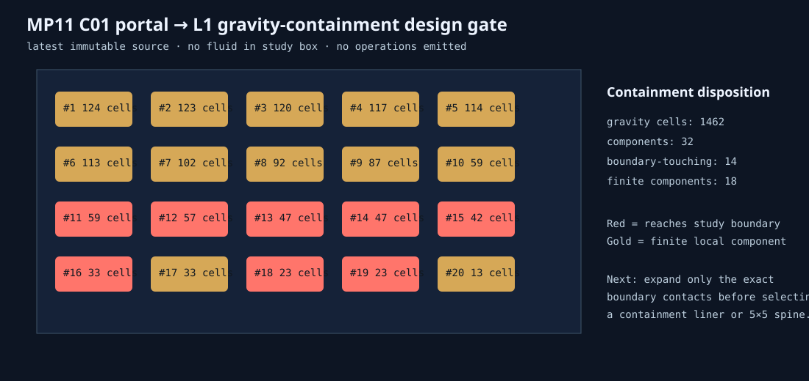

# MP11 C01 portal-to-L1 gravity containment design 01

**Status:** `HOLD_EXPAND_EXACT_GRAVITY_BOUNDARY_BEFORE_CONTAINMENT_OR_SPINE`  
**Authority:** no operations or mutation authority.

The observed 127-station route is still below the required 5×5 controlled envelope. This design inventories all **1462** gravity cells in the exact C01 study box and separates finite components from components touching its boundary. No liner, excavation, landing, or spine may be inferred until the boundary-touching components are expanded to finite bounds.
