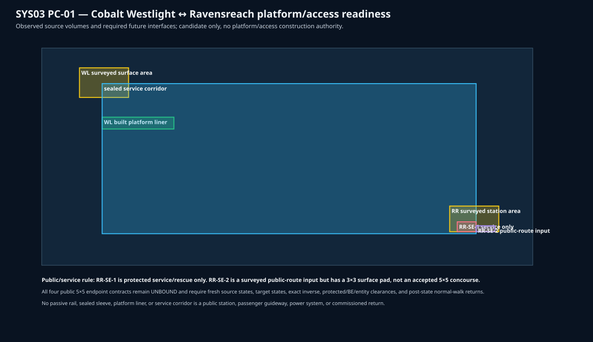

# SYS03 Cobalt PC-01 platform/access readiness 01

**Status:** `SOURCE_BOUND_PC01_READINESS_ONLY__PUBLIC_ENDPOINTS_AND_RETURNS_UNACCEPTED`

This read-only packet binds the selected **Westlight (PR-W02) ↔ Ravensreach (PR-W04)** candidate to existing platform/access evidence and lists the missing exact public contracts. It emits no targets or operations.

- Westlight has a retained 68-cell deck within a 550-cell sealed liner, but no accepted public 5×5 surface or platform interface.
- Ravensreach has an RR-SE-1 sealed **service-only** sleeve and a dry, surveyed RR-SE-2 public-route input. RR-SE-2 still has only a 3×3 surface pad and no accepted platform volume.
- Each station needs two exact, independent public surface-to-platform returns; no service shaft, rail, or maintenance corridor can substitute.

Fresh immutable source, canonical target/inverse states, fluid/gravity, block-entity/container, protected-interface, and same-moment entity clearance are mandatory before any physical compiler can be considered. PC-01 and all other passenger gates remain unaccepted.
