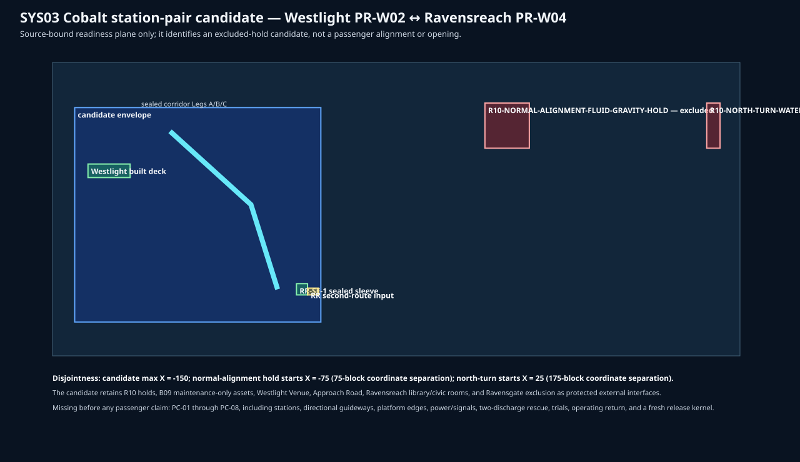

# SYS03 Cobalt Westlight ↔ Ravensreach disjoint station-pair readiness 01

**Status:** `SOURCE_BOUND_CANDIDATE_ONLY__PC01_TO_PC08_UNACCEPTED`

The sole candidate is **Westlight (PR-W02) ↔ Ravensreach (PR-W04)**. Its finite envelope is `X=-260…-150, Y=12…63, Z=-470…-376`. It is geometrically disjoint from both R10 holds: normal-alignment starts at X=-75 and north-turn starts at X=25.

The map binds existing passive rail and civil inputs, but the SYS03 gate has **0/8** accepted passenger commissioning gates. Every listed platform, guideway, power/signal, rescue, return, and protected-interface requirement remains a future acceptance input. No passenger service, opening, or construction authority follows from this design.
